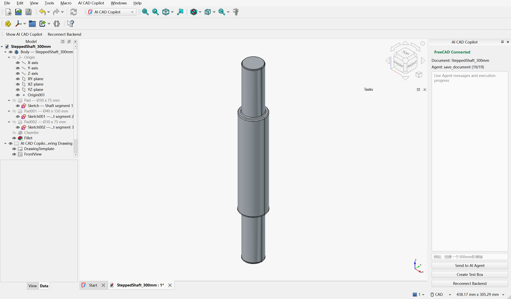
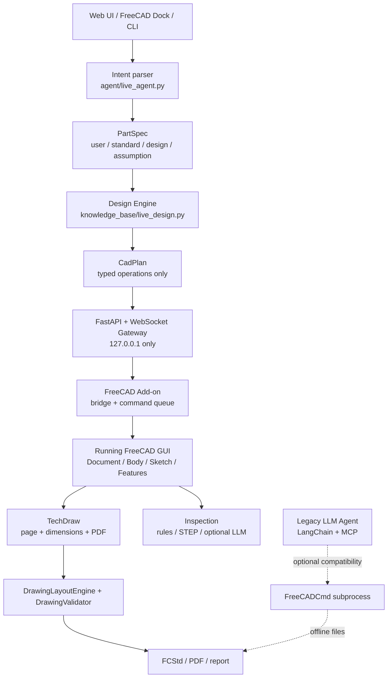
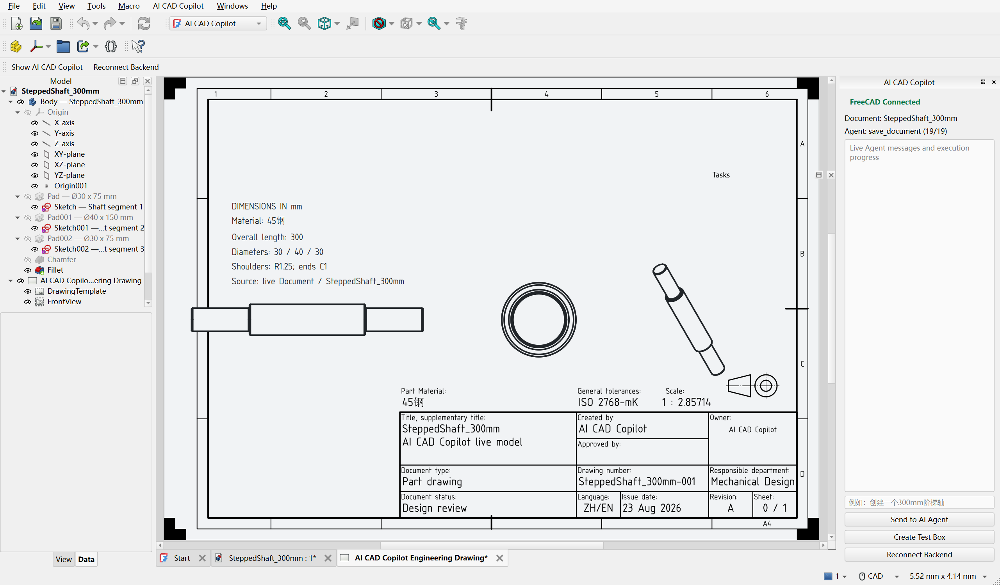
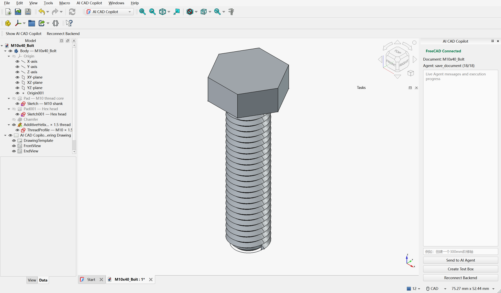
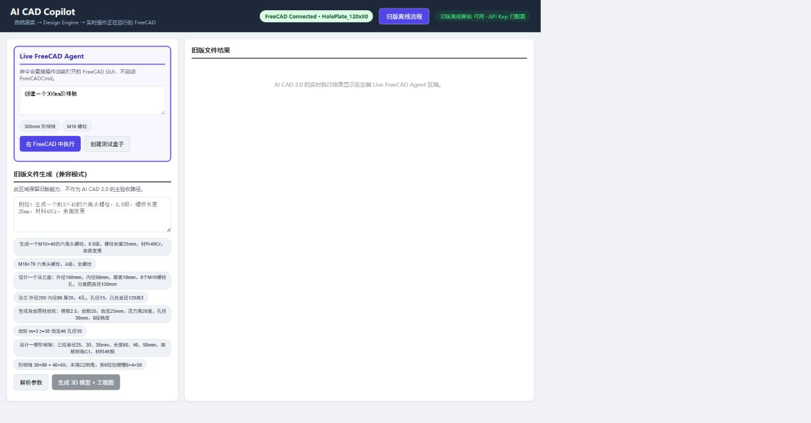

<p align="center">
  
</p>

<h1 align="center">AI CAD Copilot</h1>

<p align="center">
  <b>自然语言 → Design Engine → 原生 FreeCAD 参数化特征树 → TechDraw 工程图 → 规则检查</b><br/>
  <b>Natural language → Design Engine → native FreeCAD feature tree → TechDraw → inspection</b>
</p>

<p align="center">
  
  
  
  
  
  
</p>

<p align="center">
  <a href="#中文">中文</a> ·
  <a href="#english">English</a> ·
  <a href="docs/user_quick_start.md">快速启动</a> ·
  <a href="docs/installation.md">安装</a> ·
  <a href="docs/troubleshooting.md">故障排查</a> ·
  <a href="docs/architecture.md">架构</a>
</p>

> **发布状态 / Release status — v0.2.0 public preview**
>
> 这是一个**可复现的研究与教学原型**，不是工业级 CAD 自动出图产品。Live FreeCAD GUI 链路在
> 2026-08 的 Windows + FreeCAD 1.1.3 环境中做过真实 GUI 验收；本次公开发布重新执行了
> 52 个 Python 测试、API/网页冒烟测试、Legacy FreeCADCmd 建模和前端生产构建。
> **本次发布环境未能重新完成一次全新的 FreeCAD GUI 验收**（GUI 进程在当前自动化会话中提前退出），
> 因此 GUI 证据按“历史验收记录”标注，而不是“今天在第二台干净机器上复验通过”。
>
> This is a reproducible research/teaching prototype, **not** a production-grade drawing
> automation product. The live FreeCAD GUI path was accepted on Windows + FreeCAD 1.1.3 in
> Aug 2026. This public release re-ran 52 Python tests, API/web smoke tests, legacy
> FreeCADCmd modelling, and a production frontend build. A fresh GUI acceptance on a
> second clean machine was **not** completed in this release environment; GUI evidence is
> therefore labelled as historical acceptance evidence.

---

## 中文

### 1. 项目简介

AI CAD Copilot 是一个面向机械设计学习与原型验证的开源项目。它把中文自然语言需求转换为
可追溯的 `PartSpec`，由 Design Engine 补全尺寸假设，再编译为只包含白名单操作的 `CadPlan`。
在主路径中，运行在 FreeCAD GUI 内的 Add-on 通过本机 WebSocket 接收这些操作，直接在当前
Document 中创建原生 `Body`、`Sketch`、`Pad`、`Pocket`、`AdditiveHelix`、`Chamfer`、
`Fillet` 等参数化特征，并从同一个 Document 生成 TechDraw 工程图。

项目也保留了早期“Backend 启动 FreeCADCmd 生成文件”的离线兼容链路，用于无 GUI 环境下的
建模、导出与回归测试。两条链路在代码、网页和文档中明确区分，不把离线文件生成当作 Live GUI 验收。

### 2. 项目目标与应用场景

**目标**

- 让机械专业学生用一个可运行的项目理解“规则/LLM 设计 → CAD 内核 → 工程图 → 检查”的完整链路。
- 探索一种可审计的自然语言 CAD 交互：每个尺寸标注来源（用户 / 标准 / 设计引擎 / 假设），
  执行端只接受结构化操作，而不是让模型生成任意 Python。
- 保留真实的 FreeCAD 参数化历史，使模型可编辑、可撤销、可保存、可重新打开。

**适用场景**

| 场景 | 能做什么 | 不能做什么 |
|---|---|---|
| 课堂演示 | 一句话创建阶梯轴或 M 规格螺栓，观察特征树实时生长 | 替代系统性的 CAD 建模课程 |
| 原型评审 | 快速得到可编辑模型、TechDraw 页面和检查报告 | 直接用于生产制造 |
| 二次开发 | 在 `CadPlan` / Add-on 操作层增加新特征、新零件 | 保证任意拓扑都能自动规划 |
| 规则研究 | 扩展机械设计规则、工程图布局与校验规则 | 宣称覆盖全部 GB/T / ISO 标准 |

### 3. 功能清单

状态定义：**已验证** = 有可复现测试或已记录的真实运行证据；**部分验证** = 代码与单元测试存在，
但缺少本版本的完整 GUI/干净环境复验；**未实现** = 当前代码不提供。

| 能力 | 状态 | 说明 |
|---|---|---|
| FastAPI Backend | 已验证 | `/api/health`、Live Bridge 状态、Legacy 会话/建模/审查接口；本次启动并通过 HTTP 冒烟 |
| Vue 3 前端 | 已验证 | `frontend/src` 可生产构建，`frontend/dist` 随仓库提供，FastAPI 直接托管 |
| FreeCAD Add-on / Workbench | 已验证（历史 GUI 验收） | 注册 Workbench、右侧 Dock、模型树、连接状态；本次环境未重新拉起 GUI |
| Live FreeCAD Bridge | 已验证（历史 GUI 验收） | 本机 WebSocket、心跳、重连、命令队列、localhost 边界 |
| 原生参数化特征 | 已验证（历史 GUI 验收） | Body / Sketch / Constraint / Pad / Pocket / AdditiveHelix / Chamfer / Fillet |
| 阶梯轴 Live 建模 | 已验证（历史 GUI 验收） | “创建一个 300mm 阶梯轴”；3 段轴、倒角、轴肩圆角、同源 TechDraw |
| M 规格螺栓 Live 建模 | 已验证（历史 GUI 验收） | M10 规格派生、真实 `AdditiveHelix` 螺纹、倒角、TechDraw |
| 法兰 / 带孔板 Live 规划 | 部分验证 | 有 PartSpec、CadPlan 与单元测试；本次未完成新的 GUI 复验 |
| 直齿齿轮 | 仅 Legacy | Live `PartSpec` 不支持 gear；Legacy 为简化齿形，不是精确渐开线 |
| PartSpec / CadPlan | 已验证 | Pydantic 强类型；尺寸来源与假设可追溯；执行端白名单 |
| Design Engine | 已验证 | 轴、螺栓、法兰、带孔板的尺寸策略；无载荷时明确记录假设 |
| TechDraw 同源工程图 | 已验证（历史 GUI 验收） | 同一 Document 的页面、视图、关联尺寸、PDF 导出 |
| DrawingLayoutEngine | 已验证 | A4/A3、标准比例、安全区、视图/尺寸/标题栏避碰 |
| DrawingValidator | 已验证 | 越界、比例、重叠、必需尺寸、关联尺寸、中心线等硬门槛 |
| MechanicalDrawingRuleEngine | 已验证 | 按零件类型选择必需视图与尺寸角色（轴 / 法兰 / 板 / 螺栓） |
| 检查规则 / STEP 审查 | 已验证 | 27 条决策规则、STEP 特征与可制造性检查；LLM 审查可选 |
| 一键启动 / 停止 | 已验证（历史） | Windows 启动器、插件安装、Backend 托管、停止脚本；当前自动化会话未复验完整 GUI 启动 |
| 测试 / 示例 / 截图 | 已验证 | 52 个 Python 测试、示例 JSON/FCStd/STEP/PDF、真实 GUI 截图 |
| 任意拓扑自动规划 | 未实现 | Live 入口是确定性解析 + 模板化 CadPlan，不是任意零件生成器 |
| 装配 / FEA / 图纸 OCR | 未实现 | 无装配约束、无 CalculiX、无图像输入链 |
| 完整 GD&T / 粗糙度自动标注 | 未实现 | TechDraw 只覆盖当前记录的视图与关键尺寸 |

### 4. 系统架构



更完整的分层、信任边界与扩展点见 [docs/architecture.md](docs/architecture.md)。

### 5. 技术栈

| 层 | 技术 |
|---|---|
| Backend | Python 3.10–3.12、FastAPI、Uvicorn、Pydantic v2 |
| Live Bridge | FastAPI WebSocket、FreeCAD Add-on（PySide）、命令队列、心跳与重连 |
| CAD | FreeCAD 1.1.x / OpenCascade；PartDesign、Sketcher、TechDraw |
| Design / Inspection | 自研规则引擎、`PartSpec` / `CadPlan`、STEP 特征与可制造性检查 |
| Legacy Agent | LangChain / LangGraph、MCP、FastMCP、DeepSeek（可选） |
| Frontend | Vue 3、Vite；预构建 `dist` 由 FastAPI 托管 |
| Tests | pytest、FastAPI TestClient；真实 FreeCADCmd 建模回归 |

### 6. 核心模块说明

| 路径 | 职责 |
|---|---|
| `backend/main.py` | REST API、Live WebSocket、静态前端、统一错误处理 |
| `backend/freecad_gateway.py` | 连接注册、心跳、RPC、事件、离线错误 |
| `backend/live_freecad_executor.py` | Backend 侧 Live 执行器（不导入 FreeCAD） |
| `agent/live_agent.py` | 自然语言解析、PartSpec、CadPlan、执行编排、报告 |
| `agent/live_schema.py` | PartSpec / CadPlan / operation / result 的强类型 schema |
| `knowledge_base/live_design.py` | 阶梯轴、螺栓、法兰、带孔板的设计策略 |
| `knowledge_base/rules_data.py` | 27 条机械设计决策规则（5 类） |
| `freecad_addon/AICADCopilot/` | Workbench、Dock、Bridge、Observer、白名单原生操作 |
| `freecad_addon/AICADCopilot/drawing/` | `layout_engine`、`validator`、`rule_engine` |
| `inspection/` | 规则、STEP、公差、工程图一致性、可选 LLM 审查 |
| `cad_engine/` | Legacy FreeCADCmd 内核、零件库、MCP Server、SVG/PDF 辅助 |
| `frontend/` | Vue 3 单页界面；`dist/` 为可直接托管的构建产物 |

### 7. 项目截图

**Live FreeCAD：阶梯轴的原生特征树**


**同一 Document 生成的 TechDraw 工程图**



**M10 螺栓：真实 `AdditiveHelix` 螺纹与特征树**



**网页中的 Live Agent 连接状态与 Feature Tree**



### 8. 演示视频 / GIF

当前发布**没有**经过剪辑的演示视频或 GIF，因此不放置伪造的动图。上面的截图来自真实
FreeCAD GUI 会话。若后续录制，请使用真实操作并注明 FreeCAD 版本与零件参数。

### 9. 系统要求

| 项目 | 要求 |
|---|---|
| 操作系统 | Windows 10 / 11 x64；一键脚本使用 PowerShell 5.1+ |
| FreeCAD | 1.1.x；发布验收使用 **1.1.3**。1.0.x 未验证 |
| Python | 3.10–3.12；发布验收使用 **3.12.7** |
| Node.js | 18+，仅修改/重建前端时需要；发布验收使用 24.19 |
| 内存 | 建议 8 GB 以上（FreeCAD GUI + Backend + 浏览器） |
| 端口 | 默认 `127.0.0.1:8000` 可用 |
| LLM Key | 可选。Live Agent 不依赖 LLM；Legacy 解析无 Key 时回退规则 |

### 10. 安装步骤

```powershell
git clone https://github.com/linye-Del/ai-cad-copilot.git
cd ai-cad-copilot

python -m venv .venv
.\.venv\Scripts\Activate.ps1
python -m pip install --upgrade pip
python -m pip install -r requirements.txt

Copy-Item .env.example .env
# 可选：编辑 .env，填写 DEEPSEEK_API_KEY 或 FREECAD_GUI/FREECAD_BIN

python check_environment.py
```

安装 FreeCAD 插件：

```powershell
python scripts\install_freecad_addon.py --json
```

默认安装到 `%APPDATA%\FreeCAD\Mod\AICADCopilot`。便携版可用 `--appdata` 指向隔离目录。
完整步骤（含 FreeCAD 安装、代理、路径）见 [docs/installation.md](docs/installation.md)。

### 11. 一键启动方式

Windows 用户双击：

```text
start_ai_cad.bat
```

启动器会：检查 Python / FreeCAD / 依赖 / 端口 → 安装或更新 Workbench → 启动 Backend →
启动 FreeCAD GUI → 打开网页 → 等待 `FreeCAD Connected`。停止时双击 `stop_ai_cad.bat` 或运行
`stop_ai_cad.ps1`。

启动器会创建**当前用户级**的 Windows 计划任务来托管 Backend（无需管理员权限）。如果企业策略
禁用计划任务，请使用下一节的手动启动方式；不要用任务管理器强杀 Python 进程。

### 12. 手动启动与故障排查

**终端 A：Backend**

```powershell
.\.venv\Scripts\Activate.ps1
python -m uvicorn backend.main:app --host 127.0.0.1 --port 8000
```

**终端 B / 桌面：FreeCAD**

正常打开 FreeCAD，选择 **AI CAD Copilot** Workbench；右侧 Dock 应显示 `FreeCAD Connected`。

**验证**

```powershell
Invoke-RestMethod http://127.0.0.1:8000/api/health
Invoke-RestMethod http://127.0.0.1:8000/api/freecad/status
```

`freecad_online` 必须为 `true`，`execution_mode` 应为 `live_gui`。浏览器打开
<http://127.0.0.1:8000>。

常见问题与逐项排查见 [docs/troubleshooting.md](docs/troubleshooting.md)，包括 Backend 未运行、
8000 端口占用、FreeCAD 未连接、插件未加载、计划任务失败、缺少前端 dist、PDF 可选依赖等。

### 13. 自然语言建模示例

在 FreeCAD Dock 或网页 **Live FreeCAD Agent** 中输入：

```text
创建一个300mm阶梯轴
创建一个M10螺栓
法兰 外径160 内径50 厚度18，8个M10螺栓孔，分度圆直径130
创建120×80×10mm带4个直径12mm孔的板
```

执行后应看到原生 `Body` / `Sketch` / `Pad` / `Pocket` / `Chamfer` / `Fillet` 等对象，
而不是一个融合后的 `Part::Feature`。尺寸来源与假设会写入结果 JSON 和报告。

Legacy 兼容路径的示例：

```text
生成一个M10×40的六角头螺栓，8.8级，螺纹长度25mm，材料40Cr，表面发黑
做一个阶梯轴：直径25×60、30×40、35×50，末端倒角C1，材料45钢
```

### 14. 工程图生成示例

对当前活动模型输入：

```text
为当前模型生成工程图
```

系统会从**同一个 Document** 创建 TechDraw 页面、投影视图、关联尺寸、标题栏和 PDF。
默认输出在：

```text
output/live/drawing_<id>/<DocumentName>_drawing.pdf
```

只有在 `DrawingLayoutEngine` 与 `DrawingValidator` 的硬门槛通过后，结果才会标记
`drawing_layout_validated=PASS`。当前覆盖的视图与尺寸规则见
[docs/mechanical_drawing_rules.md](docs/mechanical_drawing_rules.md) 与
[docs/drawing_layout_validation.md](docs/drawing_layout_validation.md)。

### 15. 测试方式

```powershell
# 52 个 Python 测试（本次发布在 Windows + Python 3.12.7 上实测 52 passed）
python -m pytest tests -q

# 前端生产构建（可选；仓库已带 dist）
cd frontend
npm ci
npm run build
```

测试覆盖：API 冒烟、无 Key 规则回退、PartSpec/CadPlan、原生特征规划、法兰/带孔板、
DrawingLayout / DrawingValidator、机械制图规则、启动脚本约束、STEP 检查回归。
真实 FreeCAD GUI 验收记录见 [docs/live_freecad_test.md](docs/live_freecad_test.md)。

### 16. 当前限制

- **不是任意零件生成器**：Live 入口只覆盖阶梯轴、M 规格螺栓、法兰、带孔板等当前模板；
  复杂拓扑、齿轮精确齿形、装配体尚未进入 Live CadPlan。
- **不是工业级自动出图**：TechDraw 已有视图、关联尺寸、中心线、比例与标题栏校验，
  但没有完整 GD&T、表面粗糙度、焊接符号、BOM、企业图框适配。
- **GUI 验收是历史证据**：本次发布未能重新完成一次全新的 FreeCAD GUI 验收；
  当前环境只重新验证了单元/API、Legacy FreeCADCmd 建模与前端构建。
- **Windows 优先**：一键启动依赖 PowerShell 与 Windows 计划任务；macOS/Linux 仅可手动运行 Backend。
- **PDF 审查依赖可选 AGPL 组件**：PyMuPDF 未放入默认依赖，若启用 PDF 审查需自行接受其许可证。
- **DXF 导出不稳定**：FreeCAD 1.1.3 的 `importDXF.export` 可能崩溃，工程图主路径使用 TechDraw + PDF/SVG。
- **LLM 不是 Live 主路径的必需项**：Live Agent 目前是确定性解析与模板规划；LLM 主要用于 Legacy MCP 路径和可选的深度审查。

### 17. 路线图

- [ ] 把更多零件族（轴承座、键槽轴、简单箱体）纳入强类型 `CadPlan` 与 GUI 回归。
- [ ] 增加 LLM 规划器，但保持“只输出白名单 CadPlan、不执行任意 Python”的边界。
- [ ] 完善 TechDraw 的 GD&T、粗糙度、中心线、剖视/局部放大与图框适配。
- [ ] 建立第二台干净 Windows 机器的 GUI 验收矩阵，并把结果纳入 Release。
- [ ] 用可选的宽松许可 PDF 库替换 AGPL 依赖，或把 PDF 审查独立为可插拔服务。
- [ ] 装配体、干涉检查、FEA（CalculiX）与图像输入链。
- [ ] 打包为可复现的 Windows 安装器 / 便携版。

### 18. 许可证

本项目代码以 [MIT License](LICENSE) 发布。FreeCAD 是独立的 LGPL-2.1+ 运行时依赖；
`neka-nat/freecad-mcp` 的 MIT 代码适配说明与第三方依赖清单见
[THIRD_PARTY_NOTICES.md](THIRD_PARTY_NOTICES.md)。

**注意**：PyMuPDF 为 AGPL-3.0 或商业双许可，默认不安装。若你启用 PDF 审查，请自行评估
AGPL 义务；这不是法律意见。许可证兼容性有疑问时，请先暂停分发相关组合，并咨询专业人士。

### 19. 贡献指南

欢迎提交 Issue 与 Pull Request。请先阅读 [CONTRIBUTING.md](CONTRIBUTING.md)，并遵守：

- 不提交真实 `.env`、API Key、令牌、个人路径或含隐私的截图。
- 涉及 FreeCAD 行为变更时，附 FreeCAD 版本、复现步骤、测试结果和截图。
- 新增 CAD 操作必须进入白名单、强类型 schema 和测试，不允许执行任意 Python。
- 提交前运行 `python -m pytest tests -q`。

### 20. 联系和问题反馈

- Bug / 功能建议：使用 GitHub Issues。
- 安全问题：请使用 GitHub Security Advisory（私有渠道），不要公开粘贴凭据或利用细节。
- 仓库：<https://github.com/linye-Del/ai-cad-copilot>

---

## English

### 1. Introduction

AI CAD Copilot is an open-source research and teaching prototype for mechanical design.
It converts a Chinese natural-language request into a traceable `PartSpec`, lets a Design
Engine fill in dimensions and assumptions, and compiles a typed `CadPlan` containing only
allow-listed operations. In the live path, a FreeCAD Add-on running in the GUI receives the
plan over a localhost WebSocket and creates native `Body`, `Sketch`, `Pad`, `Pocket`,
`AdditiveHelix`, `Chamfer`, and `Fillet` features in the active Document. TechDraw views and
a PDF are generated from that same Document.

A legacy `FreeCADCmd` file-generation path is retained for headless modelling, export, and
regression tests. It is explicitly labelled as a compatibility path, not as live GUI acceptance.

### 2. Goals and use cases

- Make the full “natural language → CAD kernel → drawing → inspection” chain reproducible
  for mechanical engineering students.
- Explore auditable CAD interaction: every dimension records whether it came from the user,
  a standard, the design engine, or an explicit assumption. The executor accepts structured
  operations, not arbitrary generated Python.
- Preserve a real parametric FreeCAD history so the model remains editable, undoable,
  saveable, and reopenable.

Typical uses: classroom demonstrations, early design reviews, CAD-agent research, and
extension of the rule/drawing pipeline. It is not a substitute for a CAD course and is not
approved for production manufacturing.

### 3. Feature status

| Capability | Status | Boundary |
|---|---|---|
| FastAPI backend | Verified | Health, live gateway, legacy sessions, static frontend; HTTP smoke passed |
| Vue 3 frontend | Verified | Source builds; prebuilt `frontend/dist` is shipped and served by FastAPI |
| FreeCAD Workbench / Dock | Verified (historical GUI) | Workbench, dock, model tree, bridge status; not re-run in this environment |
| Live WebSocket bridge | Verified (historical GUI) | Localhost only, heartbeat, reconnect, command queue |
| Native PartDesign features | Verified (historical GUI) | Body, Sketch, Pad, Pocket, AdditiveHelix, Chamfer, Fillet |
| Stepped-shaft live modelling | Verified (historical GUI) | “创建一个300mm阶梯轴”; 3 segments, chamfer, shoulder fillet, same-document TechDraw |
| M-series bolt live modelling | Verified (historical GUI) | M10 dimensions, real `AdditiveHelix` thread, chamfer, TechDraw |
| Flange / hole plate | Partially verified | PartSpec, CadPlan, unit tests; no fresh GUI acceptance in this release |
| Spur gear | Legacy only | Live `PartSpec` does not support gear; legacy tooth profile is simplified |
| PartSpec / CadPlan | Verified | Pydantic schemas, source tags, allow-listed operations |
| Design Engine | Verified | Shaft, bolt, flange, plate policies; assumptions recorded |
| TechDraw from the same Document | Verified (historical GUI) | Page, views, associative dimensions, PDF |
| DrawingLayoutEngine | Verified | A4/A3, standard scales, safe zones, collision checks |
| DrawingValidator | Verified | Border, scale, overlap, required dimensions, associativity, centrelines |
| MechanicalDrawingRuleEngine | Verified | Required views/dimension roles by part type |
| Inspection / STEP review | Verified | 27 decision rules, STEP feature/manufacturability checks, optional LLM |
| One-click start/stop | Verified (historical) | Windows launcher, add-on install, backend host, stop; not fully re-run here |
| Tests / examples / screenshots | Verified | 52 tests, example assets, real GUI screenshots |
| Arbitrary topology planning | Not implemented | Deterministic templates, not a general CAD generator |
| Assembly / FEA / drawing OCR | Not implemented | No assembly constraints, CalculiX, or image input |
| Full GD&T / roughness automation | Not implemented | Only the documented view/dimension subset |

### 4. Architecture

See the Mermaid diagram above and [docs/architecture.md](docs/architecture.md). The key trust
boundary is: the Backend never executes arbitrary FreeCAD Python. It sends a typed `CadPlan`
to the Add-on, which validates operations and dispatches them on the GUI thread.

### 5. Technology stack

Python 3.10–3.12, FastAPI, Uvicorn, Pydantic v2, FreeCAD 1.1.x / OpenCascade, Vue 3 + Vite,
pytest. Legacy LLM/MCP support uses LangChain, LangGraph, FastMCP, and an optional DeepSeek key.

### 6. Core modules

`backend/` (REST + gateway), `agent/live_agent.py` (intent → PartSpec → CadPlan), `agent/live_schema.py`
(typed schemas), `knowledge_base/live_design.py` (design policies), `freecad_addon/AICADCopilot/`
(Workbench + bridge + native operations + drawing), `inspection/` (rules, STEP, tolerances),
`cad_engine/` (legacy FreeCADCmd kernel), and `frontend/` (Vue 3 UI).

### 7. Screenshots

The screenshots above show a live stepped shaft feature tree, the same-document TechDraw
drawing, a real M10 bolt with `AdditiveHelix`, and the web Live Agent connection panel.

### 8. Demo video / GIF

No edited demo video or GIF is included in this release. The screenshots are real GUI captures;
no synthetic animation is presented as evidence.

### 9. Requirements

Windows 10/11 x64, FreeCAD 1.1.x (tested 1.1.3), Python 3.10–3.12 (tested 3.12.7), Node.js 18+
for rebuilding the frontend (tested 24.19), 8 GB RAM recommended, and localhost port 8000 free.
An LLM key is optional for the live path.

### 10. Installation

```powershell
git clone https://github.com/linye-Del/ai-cad-copilot.git
cd ai-cad-copilot
python -m venv .venv
.\.venv\Scripts\Activate.ps1
python -m pip install --upgrade pip
python -m pip install -r requirements.txt
Copy-Item .env.example .env
python check_environment.py
python scripts\install_freecad_addon.py --json
```

See [docs/installation.md](docs/installation.md) for FreeCAD versions, portable installs,
proxy settings, and isolated APPDATA testing.

### 11. One-click start

On Windows, double-click `start_ai_cad.bat`. It checks the environment, installs/updates the
Workbench, starts the backend, launches FreeCAD, opens the web UI, and waits for
`FreeCAD Connected`. Use `stop_ai_cad.bat` to stop. The backend is hosted by a per-user Windows
scheduled task (no administrator rights). If scheduled tasks are disabled by policy, use the
manual two-terminal flow.

### 12. Manual start and troubleshooting

```powershell
python -m uvicorn backend.main:app --host 127.0.0.1 --port 8000
```

Open FreeCAD, select **AI CAD Copilot**, and verify with:

```powershell
Invoke-RestMethod http://127.0.0.1:8000/api/freecad/status
```

`freecad_online` must be `true` and `execution_mode` should be `live_gui`. See
[docs/troubleshooting.md](docs/troubleshooting.md) for backend, port, bridge, add-on, task
scheduler, frontend, and optional PDF dependency failures.

### 13. Modelling examples

```text
创建一个300mm阶梯轴
创建一个M10螺栓
法兰 外径160 内径50 厚度18，8个M10螺栓孔，分度圆直径130
创建120×80×10mm带4个直径12mm孔的板
```

Legacy examples:

```text
生成一个M10×40的六角头螺栓，8.8级，螺纹长度25mm，材料40Cr，表面发黑
做一个阶梯轴：直径25×60、30×40、35×50，末端倒角C1，材料45钢
```

### 14. Drawing example

With an active model, enter:

```text
为当前模型生成工程图
```

The system creates a TechDraw page, views, associative dimensions, title block, and PDF from
the same Document. Output defaults to
`output/live/drawing_<id>/<DocumentName>_drawing.pdf`, and is only marked
`drawing_layout_validated=PASS` after the layout validator passes.

### 15. Testing

```powershell
python -m pytest tests -q      # 52 passed in this release
cd frontend
npm ci
npm run build
```

The live GUI acceptance record is in [docs/live_freecad_test.md](docs/live_freecad_test.md).

### 16. Limitations

No arbitrary-topology generation, no assembly/FEA/OCR, no complete GD&T/roughness/BOM, no
fresh second-machine GUI acceptance in this release, Windows-first launcher, optional AGPL
PDF dependency, and known FreeCAD DXF export instability. The live path is deterministic;
the LLM is optional and primarily used by the legacy MCP path and optional review.

### 17. Roadmap

More typed part families and GUI regression, an LLM planner constrained to typed CadPlans,
complete drawing annotations, a clean-machine GUI acceptance matrix, replacement of the AGPL
PDF dependency, assembly/interference/FEA, and Windows packaging.

### 18. License

MIT for this repository. FreeCAD is a separate LGPL-2.1+ runtime dependency. Adapted
`freecad-mcp` code and other third-party packages are documented in
[THIRD_PARTY_NOTICES.md](THIRD_PARTY_NOTICES.md). PyMuPDF is AGPL-3.0/commercial and is not
installed by default; users enabling PDF review must assess AGPL obligations themselves.

### 19. Contributing

Read [CONTRIBUTING.md](CONTRIBUTING.md). Never commit `.env`, API keys, tokens, personal paths,
or screenshots with private data. New CAD operations must be allow-listed, typed, and tested.
Run `python -m pytest tests -q` before opening a pull request.

### 20. Contact and issues

Use GitHub Issues for bugs and feature requests. Report security issues through GitHub
Security Advisories, not public issues. Repository:
<https://github.com/linye-Del/ai-cad-copilot>.

---

<p align="center">
  <sub>AI CAD Copilot v0.2.0 preview · MIT · FreeCAD 1.1.3 evidence · 52 tests</sub>
</p>
