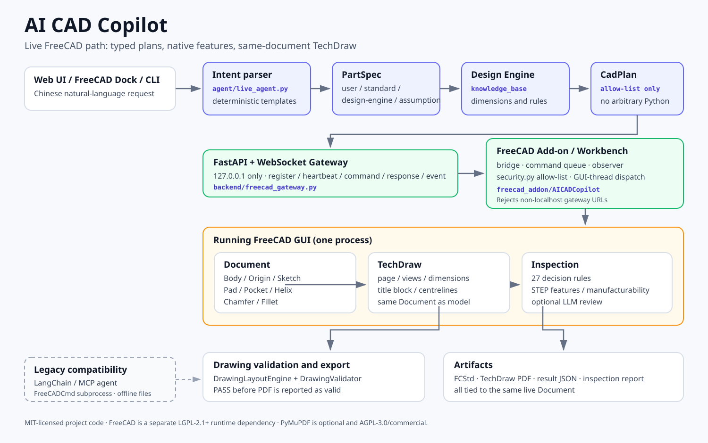

# 系统架构



AI CAD Copilot 同时保留两条明确分开的执行路径：

| 路径 | 用途 | CAD 进程 | 验收地位 |
|---|---|---|---|
| **Live FreeCAD** | 自然语言操作正在运行的 FreeCAD GUI，得到原生参数化特征树 | 用户已打开的 `FreeCAD.exe` | 主路径；有历史 GUI 验收记录 |
| **Legacy FreeCADCmd** | 无头生成 FCStd/STEP/STL/SVG，供 CI/无 GUI 环境使用 | Backend 启动的 `FreeCADCmd.exe` 子进程 | 兼容路径；不当作 Live GUI 验收 |

网页和文档中所有 Legacy 入口都标注为“兼容模式”，避免把“后台生成文件”误认为“操作 GUI”。

## 1. 分层

```text
┌─────────────────────────────────────────────────────────────┐
│ Web UI (Vue 3) / FreeCAD Dock / CLI                         │
└───────────────┬───────────────────────────────┬─────────────┘
                │ REST / WebSocket              │ Qt signals
                ▼                               ▼
┌──────────────────────────────┐   ┌───────────────────────────┐
│ backend/                     │   │ freecad_addon/AICADCopilot│
│  FastAPI, gateway, static UI │◀─▶│  bridge, queue, executor  │
└───────────────┬──────────────┘   └─────────────┬─────────────┘
                │ typed CadPlan                  │ native API
                ▼                                ▼
┌──────────────────────────────┐   ┌───────────────────────────┐
│ agent/ + knowledge_base/     │   │ Running FreeCAD GUI       │
│  PartSpec → design → CadPlan │   │  Document / Body / Sketch │
└──────────────────────────────┘   │  Pad / Pocket / Helix ... │
                                   └─────────────┬─────────────┘
                                                 │ same document
                                   ┌─────────────▼─────────────┐
                                   │ TechDraw + Drawing rules  │
                                   │ layout / validator / PDF  │
                                   └─────────────┬─────────────┘
                                                 ▼
                                   FCStd / PDF / report JSON
```

## 2. Live 路径的数据流

```text
POST /api/freecad/agent {"query": "创建一个300mm阶梯轴"}
  → agent.live_agent.parse_live_request()
  → PartSpec（每个尺寸带 source: user / standard / design_engine / assumption）
  → knowledge_base.live_design.design_stepped_shaft()
  → compile_cad_plan() → CadPlan（operations[]）
  → backend.freecad_gateway.dispatch()
  → WebSocket 127.0.0.1:8000/ws/freecad
  → Add-on command_queue（GUI 线程）
  → security.validate_command() + operation executor
  → App.ActiveDocument 原生特征
  → 每个 operation 后 recompute + GUI 更新 + event
  → TechDraw / PDF / 报告
```

`CadPlan` 只允许 schema 中列出的 operation（例如 `create_body`、`create_sketch`、
`create_pad`、`create_pocket`、`create_additive_helix`、`create_chamfer`、`create_fillet`、
`create_techdraw`、`validate_techdraw`、`export_techdraw_pdf`）。不接受任意 Python 字符串。

## 3. 信任边界

| 边界 | 措施 |
|---|---|
| 浏览器 / CLI → Backend | Pydantic 校验；统一错误码；CORS 默认仅本地开发 |
| Backend → Add-on | 仅 `ws://127.0.0.1`；`security.validate_backend_url` 拒绝远程地址 |
| Add-on → FreeCAD | 操作白名单、对象/属性白名单、GUI 线程派发、事务 |
| 报告 / 输出 | 写入项目 `output/`、`reports/`，不执行用户输入 |
| Legacy 子进程 | 环境净化（移除 `PYTHON*`、过滤 conda PATH、`stdin=DEVNULL`） |
| 凭据 | 只从 `.env` / 环境读取；`.gitignore` 排除；不写入日志 |

> 这不是生产级多用户安全模型。Backend 默认面向本机单用户；不要直接暴露到公网。
> 若要做远程/多用户部署，需要额外的认证、授权、租户隔离和审计。

## 4. 核心模块

### backend/

| 文件 | 职责 |
|---|---|
| `main.py` | FastAPI 应用、REST 路由、`/ws/freecad`、静态前端、异常处理 |
| `freecad_gateway.py` | 连接注册、心跳、RPC、事件、离线/超时错误 |
| `live_freecad_executor.py` | Backend 侧执行器接口（不导入 FreeCAD） |
| `logger.py` | 控制台 + 滚动文件日志 |

### agent/

| 文件 | 职责 |
|---|---|
| `live_agent.py` | 解析、PartSpec、CadPlan、执行、树验证、审查、报告 |
| `live_schema.py` | `ParameterSource`、`PartSpec`、`CadOperation`、`CadPlan`、`LiveAgentResult` |
| `agent.py` | Legacy LangChain ReAct + MCP 客户端 |
| `parser.py` | Legacy 自然语言 → 结构化参数（LLM + 规则回退） |

### knowledge_base/

| 文件 | 职责 |
|---|---|
| `live_design.py` | 阶梯轴、M 规格螺栓、法兰、带孔板的设计策略 |
| `decision_engine.py` | 轴径/强度等工程计算 |
| `rules.py` / `rules_data.py` | 27 条决策规则，5 类，五字段解释 |
| `gbt.py` | GB/T 公差、配合、材料等数据子集 |

### freecad_addon/AICADCopilot/

| 文件/目录 | 职责 |
|---|---|
| `Workbench.py` | Workbench、Dock、模型树、命令 |
| `bridge/` | WebSocket 客户端、命令队列、观察者、序列化、安全检查 |
| `operations/` | Document/Body/Sketch/Feature/Export 原生操作 |
| `drawing/layout_engine.py` | 页面、比例、视图、尺寸、注释布局 |
| `drawing/validator.py` | 出图硬门槛 |
| `drawing/rule_engine.py` | 按零件类型选择必需视图与尺寸 |

### inspection/

| 文件 | 职责 |
|---|---|
| `rules.py` | 基础检查 + 决策系统 + 公差检查组合 |
| `step_parser.py` / `feature_detector.py` | STEP 实体与特征语义化 |
| `manufacturability_checker.py` | 壁厚、圆角、深孔、内角、薄壁 |
| `step_review.py` | STEP 审查总入口 |
| `tolerance_check.py` | 尺寸/形位/配合公差、缺标检测 |
| `reviewer.py` | DXF/PDF/SVG 工程图一致性审查；PDF 需可选 PyMuPDF |
| `llm_check.py` | 可选 LLM 深度审查 |

### cad_engine/

Legacy 兼容层：`runner.py` 调 `FreeCADCmd`，`parts/` 提供螺栓/轴/法兰/齿轮参数化模型，
`drawing_svg.py` 生成程序化 SVG，`mcp_server/` 暴露 MCP 工具。

## 5. 工程图流水线

```text
当前 Document
  → DrawingRuleEngine.select_required_views(part_type, feature_tree)
  → DrawingLayoutEngine.layout(model_bbox, dimensions, annotations)
      · A4/A3
      · 标准比例 1:1, 1:2, 1:2.5, 1:5 ...
      · 主视图 / 端视图 / 轴测视图
      · 标题栏、安全区、尺寸避碰
  → 在 TechDraw 页面创建视图和关联尺寸
  → DrawingValidator.validate(layout, required_dimensions, associative, evidence)
  → PASS 才 export PDF；否则返回失败和具体字段
```

硬门槛包括：页面边界、标准比例、视图/尺寸/标题栏重叠、必需尺寸、关联尺寸、
中心线、尺寸链、重复尺寸、制造尺寸完整性。详见
[mechanical_drawing_rules.md](mechanical_drawing_rules.md) 和
[drawing_layout_validation.md](drawing_layout_validation.md)。

## 6. 并发与生命周期

- WebSocket 每个 Add-on 实例注册一个连接；心跳 5 秒；断线 3 秒后重连。
- 命令进入队列，由 GUI 线程执行；Backend 侧有超时和错误返回。
- 启动器通过 `logs/backend.pid`、8000 listener、`/api/health` 三方校验识别 Backend，
  避免重复启动。
- 停止通过 `logs/backend.stop` 请求正常退出；超时才走计划任务停止。
- FreeCAD 侧使用事务；失败时回滚，避免留下半成品特征树。
- Legacy 子进程失败重试 ≤2 次；会话落盘到 `output/sessions/{id}/`。

## 7. 扩展点

| 目标 | 位置 |
|---|---|
| 新零件类型 | `agent/live_schema.py` 的 `PartSpec`、`knowledge_base/live_design.py`、`agent/live_agent.py` 编译器 |
| 新原生特征 | `freecad_addon/AICADCopilot/operations/` + `live_schema.py` 白名单 + 测试 |
| 新制图规则 | `freecad_addon/AICADCopilot/drawing/rule_engine.py` |
| 新审查规则 | `knowledge_base/rules_data.py` |
| 新 REST 接口 | `backend/main.py` |
| 新 Legacy 零件 | `cad_engine/parts/` + `agent/schema.py` |

新增操作必须同时更新：schema 字面量、Add-on 白名单、执行器、单元测试/回归、
文档中的能力矩阵。不要通过“开放任意 Python”来绕过这个流程。

## 8. 已知架构限制

- Live 解析器是确定性的，不是通用 LLM 规划器；复杂拓扑需要新增编译器。
- Live 只覆盖轴、螺栓、法兰、带孔板等模板；齿轮只在 Legacy。
- TechDraw 目前没有完整 GD&T、粗糙度、剖视/局部放大、BOM。
- 单用户本机模型；没有认证、多租户、远程部署安全加固。
- Windows 一键启动依赖 PowerShell + 计划任务；Backend 本身可跨平台。
