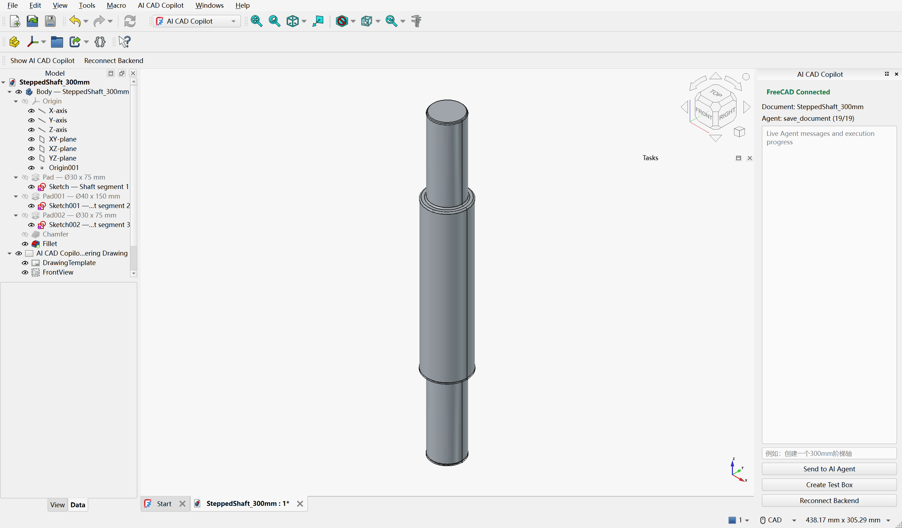
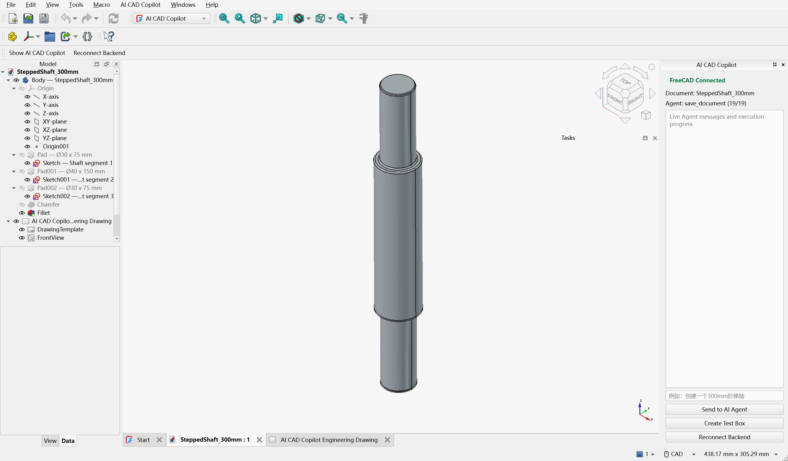
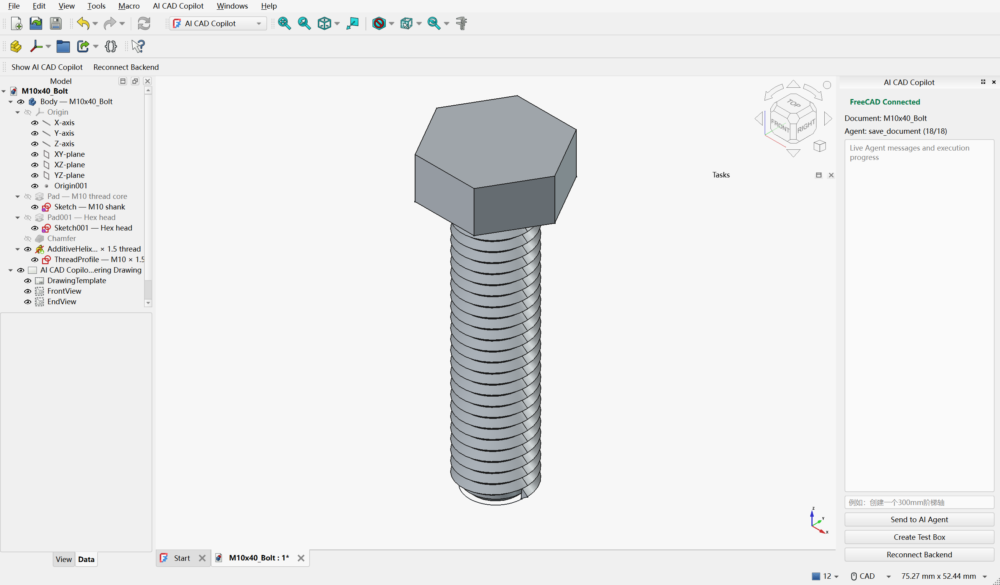
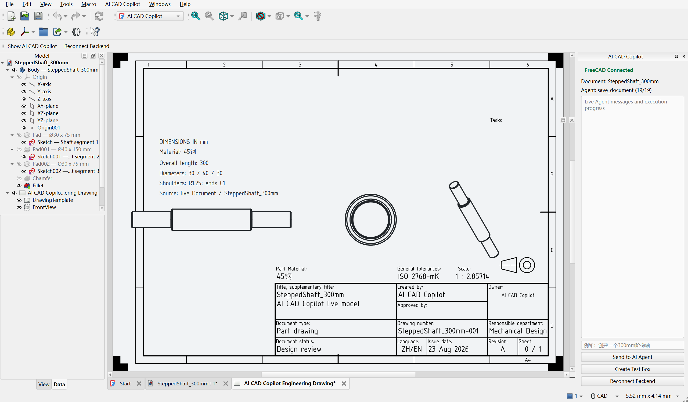

# Live FreeCAD GUI 验收记录

> **性质**：历史验收记录，不是本次 v0.2.0 发布在第二台干净机器上的复验。
> 验收时间：2026-08-23；环境：Windows、FreeCAD 1.1.3、Python 3.12。
> 本次公开发布重新运行了单元/API 测试、Legacy FreeCADCmd 建模和前端构建，但当前自动化
> 会话中的 FreeCAD GUI 进程提前退出，未能重新完成下面的 GUI 验收。

## 验收边界

本记录只把“正在运行的 FreeCAD GUI 被普通语言命令真实改变”视为通过。
`FreeCADCmd`、预生成 FCStd、SVG、后台脚本输出或单元测试结果都不作为 GUI 验收证据。

## 启动步骤

1. 将 `freecad_addon/AICADCopilot` 安装到 `%APPDATA%/FreeCAD/Mod/AICADCopilot`
   （或使用 `scripts/install_freecad_addon.py`）。
2. 在项目根目录启动 Backend：

   ```powershell
   python -m uvicorn backend.main:app --host 127.0.0.1 --port 8000
   ```

3. 正常打开 FreeCAD GUI，选择 **AI CAD Copilot** Workbench。
4. 确认右侧 Dock 显示 `FreeCAD Connected`，并能看到当前 Document。
5. 在 Dock 或网页 `http://127.0.0.1:8000` 输入自然语言。

## 实测结果

### 1. 连接与 CREATE BOX

- Add-on 注册：`freecad_online=true`
- FreeCAD 版本：`1.1.3`
- CREATE BOX 返回原生 `Part::Box`，尺寸 `50 × 30 × 20 mm`
- Document Observer 收到对象创建与 Shape 更新事件

### 2. “创建一个300mm阶梯轴”

最终 GUI 验收运行 `plan_id=d4a4ac0b58d9`，后续图纸布局交付运行
`plan_id=8620ed870ebb`。两次均返回成功，实际 Document 含 23 个对象：

- `PartDesign::Body` × 1
- `Sketcher::SketchObject` × 3（均报告 fully constrained）
- `PartDesign::Pad` × 3
- `PartDesign::Chamfer` × 1
- `PartDesign::Fillet` × 1
- `TechDraw::DrawPage` × 1
- `TechDraw::DrawViewPart` × 3
- 最终实体数 1，体积约 `294407.138 mm³`



### 3. Undo / Redo / FCStd 重开

在同一个 FreeCAD GUI Document 上执行：

| 检查 | 结果 |
|---|---:|
| AI 事务提交后对象数 | 23 |
| Undo 后对象数 | 0 |
| Redo 后对象数 | 23 |
| 关闭并从 FCStd 重开后对象数 | 23 |
| 重开后 Body / Fillet / TechDraw page | 全部存在 |

重开文件仍为原生参数化对象，而不是一个融合后的 `Part::Feature`。



### 4. “创建一个M10螺栓”

最终 GUI 验收运行 `plan_id=84466d6b5946`。Design Engine 从 M10 规格表派生
螺距、对边、头高和螺纹根径；未提供长度时明确记录 `L=4d=40mm` 为假设。
Document 含三个 Sketch、两个 Pad、`PartDesign::AdditiveHelix` M10×1.5 真实
螺旋特征、Chamfer 和同源 TechDraw，共 22 个对象、1 个实体。FCStd 重开后
22 个对象和 AdditiveHelix 仍存在。



### 5. TechDraw 同源闭环

TechDraw page、模板、正视/端视/轴测视图和说明均位于建模 Document 中，
每个 `DrawViewPart.Source` 指向最终 `Fillet`；PDF 由当前 page 导出。阶梯轴 PDF
实测大小约 42KB，不会重新运行旧建模脚本。



### 6. 网页普通语言入口

在实际网页点击“在 FreeCAD 中执行”，输入“创建一个250mm阶梯轴”，网页状态从
`FreeCAD Connected` 更新到 `SteppedShaft_250mm`，并返回 23 个实际 Feature
对象。该操作同时改变了正在运行的 FreeCAD。

## 回归测试

- Python：v0.2.0 发布时 **52 passed**（Windows 11 / Python 3.12.7）
- Vue/Vite：production build 通过
- Native API supplemental probe：原生 Body/Sketch/Pad/Chamfer/Fillet，单实体
- 主要验收：以上可见 FreeCAD GUI 运行，不依赖 `FreeCADCmd`

## 已知边界

- TechDraw 当前提供视图、标题栏与关键尺寸；完整关联式 GD&T、表面粗糙度、
  剖视/局部放大仍是后续增强项。
- Live Agent 当前自然语言模板覆盖阶梯轴、M 规格螺栓、法兰、带孔板；底层执行器
  已实现 Revolution/Pocket，但尚未给更多零件编译器生成对应 CadPlan。
- 齿轮只在 Legacy 路径，且齿形为简化轮廓。
- 本记录不包含第二台干净 Windows 机器的复验；v0.2.0 发布报告会单独说明。
